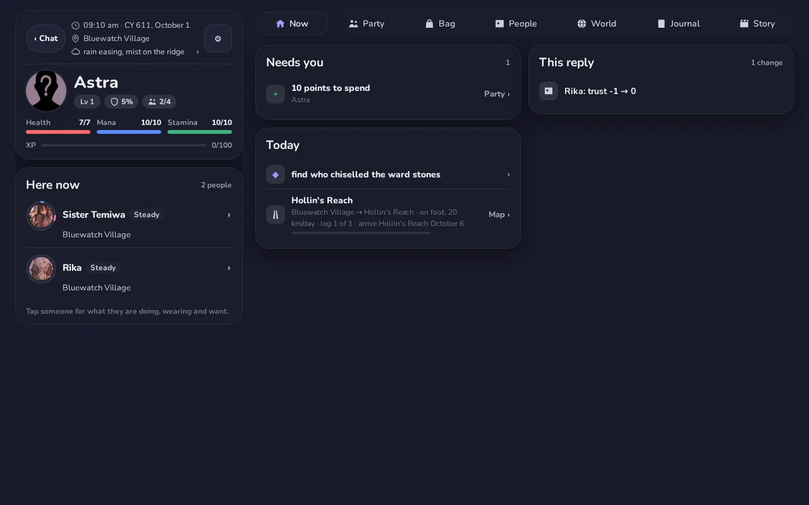
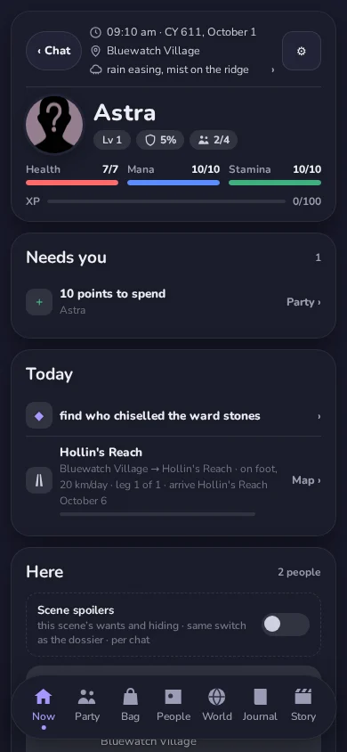
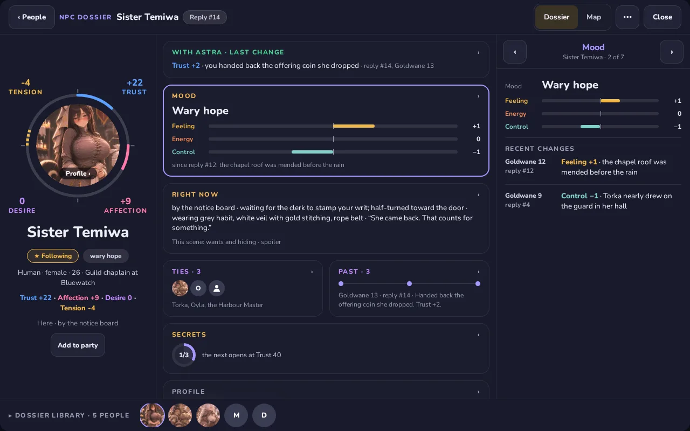
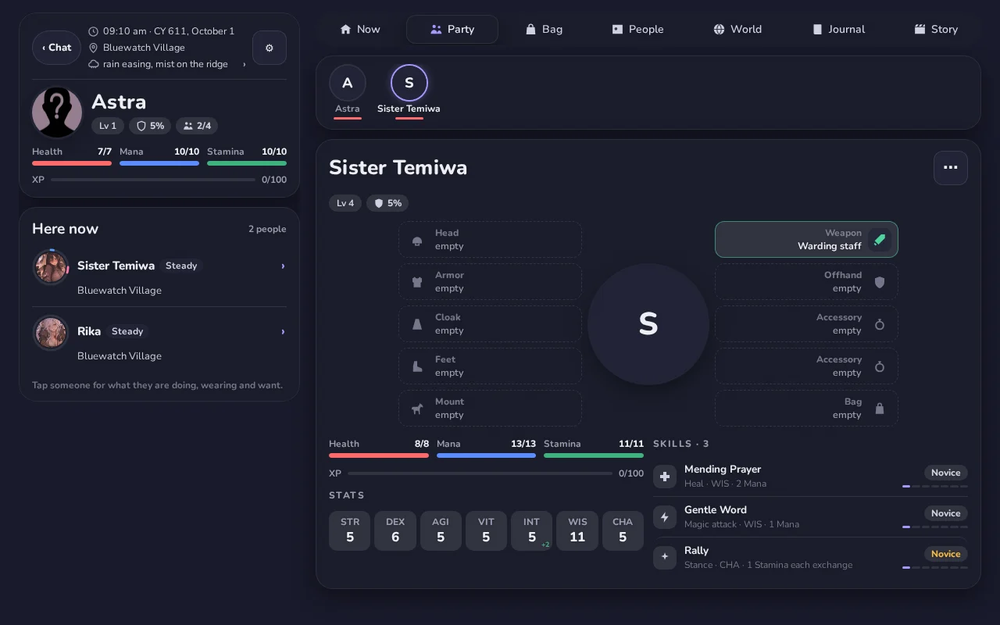
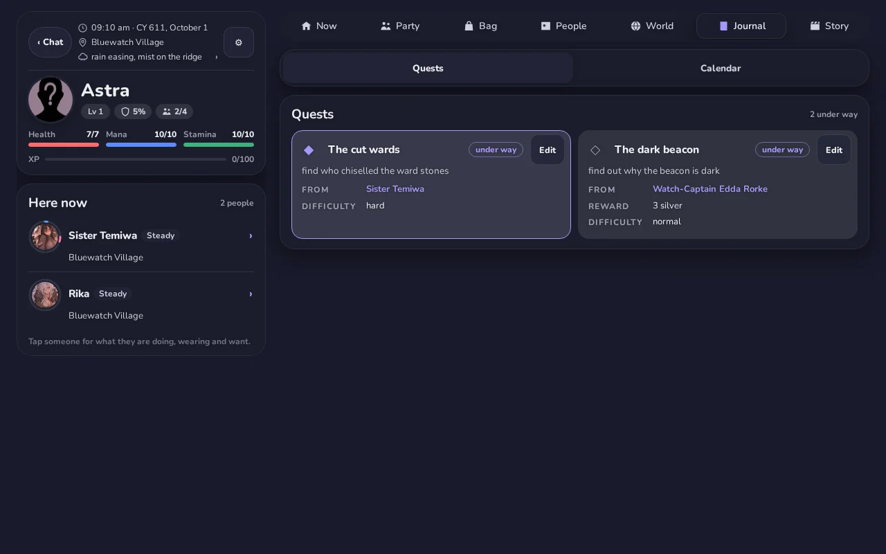
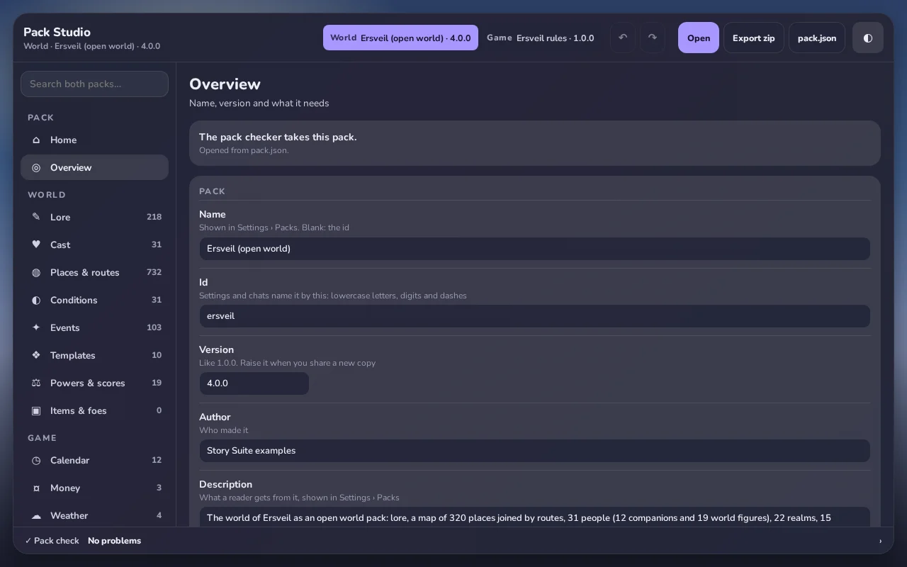

# Story Suite 0.1.5

Story Suite is a SillyTavern extension that keeps track of your story for you: your items and money, the scene, the people you meet, the clock and calendar, quests, the map and fights. It puts that state in front of the narrator, and in front of you in a view of its own.

  
  

<table>
  <tr>
    <td width="50%"> <b>People:</b> a dossier for everyone you meet.</td>
    <td width="50%"> <b>Party:</b> gear, stats and skills for each member.</td>
  </tr>
  <tr>
    <td width="50%"> <b>Journal:</b> quests and the calendar.</td>
    <td width="50%"> <b>Pack Studio:</b> write and check your own world.</td>
  </tr>
</table>

## Install

You need SillyTavern 1.19 or newer.

1. In **Extensions → Manage extensions**, delete Story Block, Story Director and NPC State Delta if you have them. Disabling is not enough.
2. Reload SillyTavern.
3. Open **Extensions → Install extension**, paste `https://github.com/kohz87/story_suite`, and install it.
4. Reload again.

To update, press the update button in **Extensions → Manage extensions**. Full steps are in [docs/INSTALL.md](docs/INSTALL.md); questions are answered in [docs/FAQ.md](docs/FAQ.md).

Story Suite is one extension. It replaces Story Block, Story Director and NPC State Delta, and nothing is carried over from them.

## What it does

- **Its own view.** Tabs for Now, Party, Bag, People, World, Journal and Story, a Fight tab while a fight is on, and one Settings window. Dark and light. On a wide screen your character and the people here stay on the left.
- **Every reply's changes.** The line under each reply lists what it changed. When a reply forgets its change block, a safety net reads the story and fills it in.
- **NPC State.** A dossier for every person you meet: who they are, where they are and how they feel about you (Trust, Affection, Desire, Tension, and meters of your own). A stranger stays unnamed until the story names them.
- **The Story Director.** Plans arcs, quests and the day's happenings, and keeps the clock and calendar. With **World events** on, the world moves on its own, and news travels by courier.
- **Fights.** One set of rules, Combat Rules v1, played on the fight board. You choose for each party member; code rolls the dice; the story is told afterwards.
- **Bag and money.** Items, gear and coins from the story's own change lines, in the game's currency.
- **Replay is exact.** Edits, swipes, deletes, rewinds and reloads give the same state as live play.

## Packs

- A **world pack** brings the world: lore, people, places, routes and events. A **game pack** brings the rules: calendar, money, weather, names and RPG options. This is pack format 4.
- The sample is **Ersveil**: [examples/packs/ersveil.zip](examples/packs/ersveil.zip) holds the world (31 people, 218 lore entries, 320 places, 103 world events) and its game, "Ersveil rules".
- Install a pack in **Settings › Packs and trackers › Import a pack file**, pick the world and the game there, then start a new chat. A chat keeps the world and game it began with.
- **Pack Studio** (**Settings › Packs and trackers › Open Studio**) edits world and game packs, checks them, runs them forward in a Dry run, and exports a zip. An older pack opens read only; convert it there or with `scripts/packs/convert-3to4.mjs`.
- Guides: [docs/v2/PACKS.md](docs/v2/PACKS.md) (the pack format), [docs/v2/ERSVEIL.md](docs/v2/ERSVEIL.md) (playing Ersveil), [docs/dev/studio.md](docs/dev/studio.md) (the Studio).

Coming in the next release: a SillyTavern lorebook made from a world pack's lore, and Export lorebook in the Studio. See [Unreleased](CHANGELOG.md#unreleased).

## Settings at a glance

| Page | What you set there |
| --- | --- |
| Start | How much the suite tracks, and the modules with their features |
| Look | Skin and text, dark or light |
| People | Feelings and their pacing, stages, who gets a dossier, portraits, the people in this chat |
| RPG and fights | Combat Rules v1, progression, fights, and what you take, carry and wear |
| World and time | The calendar, weather, the map, time rules, World events |
| Director | Checks, spoilers, the pulse, the planner for arcs and the cast |
| Money | Coins and prices |
| Chat extras | Choices, inner chatter and your look |
| Models | The connection each kind of call uses, and the one fallback call |
| Packs and trackers | Your world and game, data modules, trackers, the Pack Studio |
| Add-ons | The plug-in modules installed |
| Tools | What is sent, budgets, prompts, the inspector, problems, diagnostics and chat data |

Each page has its own help lines, and the search box at the top finds a setting by name.

## Versions

- **0.1.3** (19 Nov 2026): pack format 4 (world + game packs), the Pack Studio, the desktop layout, many fixes. [Changes](CHANGELOG.md#013--19-nov-2026)
- **0.1.2** (18 Nov 2026): short generated arcs, making your character in the new view. [Changes](CHANGELOG.md#012--18-nov-2026)
- **0.1.1** (18 Nov 2026): world events, the Director directs, the sample world Ersveil. [Changes](CHANGELOG.md#011--18-nov-2026)
- **0.1.0** (18 Nov 2026): first release as one extension. [Changes](CHANGELOG.md#010--18-nov-2026)

Earlier versions of the three old extensions: [docs/history/packages/](docs/history/packages/).

## For developers

Node 24. Run `npm ci` first.

| Command | What it does |
| --- | --- |
| `npm test` | Every test folder, then the cross-module suite |
| `npm run check` | Size, code map, changelog and syntax checks |
| `npm run codemap` | Regenerate [docs/codemap.md](docs/codemap.md), `docs/codemap/` and [AI-README.md](AI-README.md) |
| `npm run release:check` | Build the release bundles in a temporary folder and run the release gate |
| `node scripts/release.mjs <version>` | Write a version into every place that carries it |

- `core/` is the host (store, replay, commands, prompt, the module SDK); `modules/` holds scene, inventory, assist, rpg, time, atlas, world, cast, arc and people (NPC State); `ui/` is the view; `packs/` and `studio/` handle packs.
- Every file is at most 450 lines and does one job. The code map is generated and checked in CI.
- A release is a version bump merged to main; releases are not tagged.

Read next: [CLAUDE.md](CLAUDE.md) (rules for coding agents), [AI-README.md](AI-README.md), [docs/dev](docs/dev), [docs/v2](docs/v2).

## Credits

By kohz87 (see `manifest.json`). The repository states no licence.
