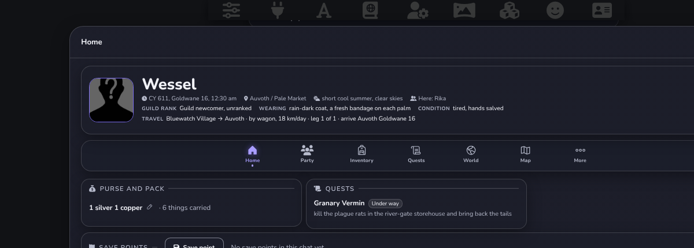

# Story Suite 0.1.2

Story Suite is a SillyTavern extension that keeps track of your story for you: your items and money, the scene, the people you meet, the clock and calendar, quests, the map and fights. It puts that state in front of the narrator and in front of you, in a view of its own.

It is one extension made from what used to be Story Block, Story Director and NPC State Delta. Version 0.1.0 is its first release. The old three are not kept up to date, and nothing is carried over from them.

## Install

You need SillyTavern 1.19 or newer.

1. In **Extensions → Manage extensions**, delete Story Block, Story Director and NPC State Delta. Disabling is not enough.
2. Reload SillyTavern.
3. Open **Extensions → Install extension**, paste `https://github.com/kohz87/story_suite`, and install it.
4. Reload again.

To update later, press the update button in **Extensions → Manage extensions**. Nothing else is needed. Full steps are in [docs/INSTALL.md](docs/INSTALL.md); questions are answered in [docs/FAQ.md](docs/FAQ.md).

## What it does

**The new view**
- Tabs for Now, Story, People, Party, Bag, World and Fight, and one Settings overlay, in dark and light.
- Each reply's menu and the line under it list what that reply changed.
- Your character is made in the view itself, with the New character window.

**NPC State**
- Keeps a dossier for every person you meet: who they are, where they are, how they feel about you.
- Four feelings are always kept for each person: Trust, Affection, Desire and Tension, from −100 to +100, where 0 is neutral. Settings › People adds up to six meters of your own (Fear, Respect, Debt…), meter presets, named stages on one meter and a stage ladder.
- A person you have not met by name stays unnamed to the narrator until the story names them.
- A pack's secrets for a person stay hidden until their condition is met.

**The Story Director and world events**
- The Director plans arcs, quests and the day's happenings, and keeps the clock and calendar.
- With **World events** on (off by default), the world moves on its own: events, conditions, news that travels by courier, and short generated arcs.

**Combat Rules v1 and the fight board**
- One set of rules and one way to fight. Every fight is played by code on the fight board.
- You choose for each party member; the dice are rolled by code; the story is told afterwards.

**Inventory and money**
- Items, gear and coins are tracked from the story's own change lines, in the chat's currency.
- Bag shows the purse, what happened this turn, and what each person carries.

**Packs**
- A world pack brings a world: lore, cast, places, routes and events. The sample world pack is Ersveil.

**The change-block repair**
- When a reply forgets its change block, a safety net reads the story and writes the missing changes, so the state stays right.
- Edits, swipes, deletes, rewinds and reloads all give the same state as live play.

## Settings at a glance

| Page | What you set there |
| --- | --- |
| Start | How a new chat begins |
| Look | How the view looks (dark or light, and its details) |
| People | NPC State options |
| RPG | Combat Rules v1 on or off, and their options |
| World and time | The clock, the calendar, World events and Tempo |
| Director | How the Story Director plans |
| Money and Chat extras | The currency, and small extras for the chat |
| Models | The connection each model call uses: story, quick helpers, background work, the safety net |
| Packs and trackers | Install, switch off or remove a pack; trackers |
| Add-ons | Modules and the switch on each one's card |
| Tools | Save points, the budget view, the inspector, developer tools |
| Diagnostics | Parts that failed to start, and the problems they report |

Each page has its own help lines; the search box at the top of Settings finds a setting by name.

## Packs

- A world pack is a `.zip` (or a `pack.json` with its images). Packs use **format 3**; a pack names the suite it needs with `requires.suite`.
- Install one in **Settings → Packs and trackers → Import a pack file**, then start a new chat.
- The sample world pack is **Ersveil**: `examples/packs/ersveil-world.zip` (source in `examples/packs/ersveil-world/`). It has 31 people, lore, realms, conditions and 103 world events. Its world events run only with World events on. A smaller `examples/packs/ersveil.zip` is also there.
- The author spec and the install checks are in [docs/v2/PACKS.md](docs/v2/PACKS.md) and [authoring-kit/reference/PACK-FORMAT.md](authoring-kit/reference/PACK-FORMAT.md). [docs/v2/ERSVEIL.md](docs/v2/ERSVEIL.md) walks through playing Ersveil.
- Pack Studio (`studio/index.html`) opens and checks a pack, read only: see [docs/dev/studio.md](docs/dev/studio.md).

## For developers

Node 24. Run `npm ci` first (`acorn`, `acorn-walk`, `esbuild`, `playwright`).

Layout:
- `core/`: host runtime, store, persistence and replay, command bus, prompt assembly, the module SDK.
- `modules/`: scene, inventory, data-modules, assist, rpg, time, atlas, world, cast, arc, people (NPC State).
- `ui/`: the new view and its settings; the old view was removed at B4-4.
- `packs/`: pack import, validation, portraits, installed packs.
- `testkit/`, `examples/`, `authoring-kit/`, `assets/`: test fakes, the Fishing example and example packs, the pack authoring kit, images.
- `scripts/`, `tests/`: checks, code map, release build and gate; all tests.
- `docs/`: guides, the generated code map, and `docs/history/` with the three old repositories' changelogs.

| Command | What it does |
| --- | --- |
| `npm test` | Every test folder, then the cross-module suite |
| `npm run check` | Size, code map and syntax checks |
| `npm run codemap` | Regenerate [docs/codemap.md](docs/codemap.md) and `docs/codemap/` |
| `npm run release:check` | Build the release bundles in a temporary folder and run the release gate |
| `node scripts/release.mjs <version>` | Write a version into every place that carries it |

A release is a version bump merged to main; releases are not tagged.

Rules:
- Every source and test file is at most 450 lines; each file does one job with at most 4 exports.
- The code map ([docs/codemap.md](docs/codemap.md)) is generated and checked in CI.
- Replay equals live: swipes, middle deletes, rewinds and reloads reproduce the same state.

Read next: [CLAUDE.md](CLAUDE.md) (rules for coding agents), [docs/dev](docs/dev), [docs/v2](docs/v2), [the code map](docs/codemap.md).

## Versions

- **0.1.2** (18 Nov 2026): generated arcs, character wizard in the new view. [Changes](CHANGELOG.md#012--18-nov-2026)
- **0.1.1** (18 Nov 2026): world events, the Director directs, sample pack Ersveil. [Changes](CHANGELOG.md#011--18-nov-2026)
- **0.1.0** (18 Nov 2026): first release as one extension. [Changes](CHANGELOG.md#010--18-nov-2026)

Earlier versions of the three old extensions: [docs/history/packages/](docs/history/packages/).

## Credits

By kohz87 (see `manifest.json`). The repository states no licence.
